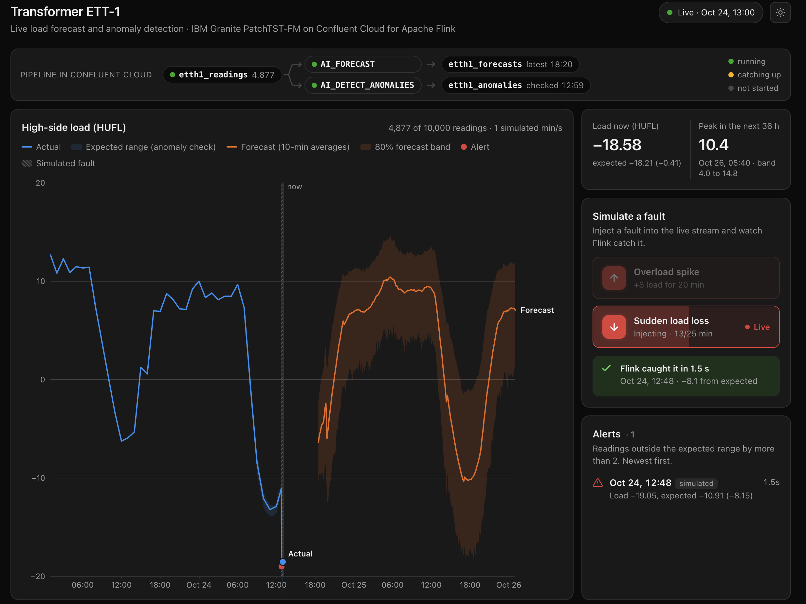
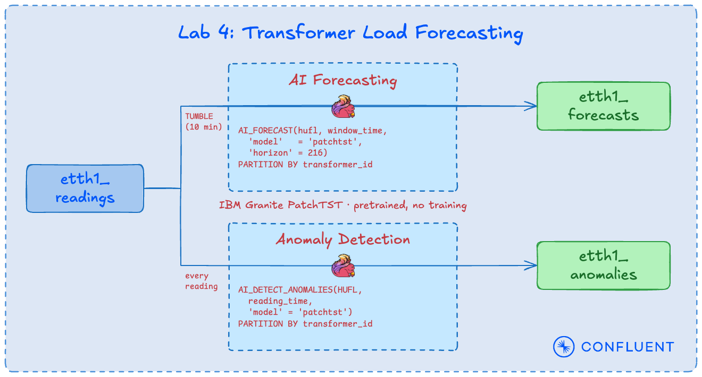
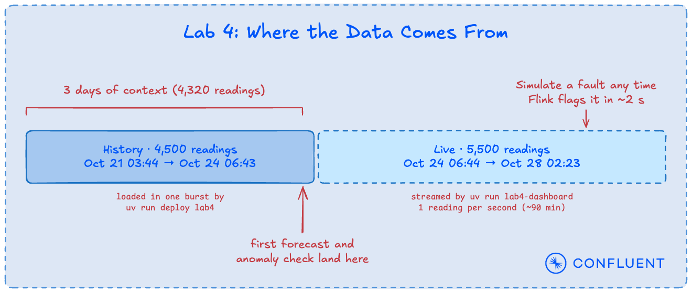

# Lab 4: Transformer Load Forecasting and Anomaly Detection with IBM Granite

Forecast a power transformer's load 36 hours ahead and catch faults the moment they happen, with two SQL statements and no model training.

Built on **Confluent Cloud for Apache Flink** with `AI_FORECAST` and `AI_DETECT_ANOMALIES`, running **IBM Granite PatchTST-FM**, a pretrained time-series foundation model that Confluent hosts for you.

[AI_FORECAST docs](https://docs.confluent.io/cloud/current/ai/builtin-functions/forecast.html) · [AI_DETECT_ANOMALIES docs](https://docs.confluent.io/cloud/current/ai/builtin-functions/detect-anomalies.html)



---

## Business Context

**VoltGrid Utilities** runs thousands of substation transformers. Each one reports its electrical load every minute.

**The Problem:** Load is planned from yesterday's spreadsheet, and faults are found when a transformer trips. Overloads shorten a transformer's life, and an unplanned outage takes out a whole neighborhood.

**The Solution:** Treat the readings as a stream. Forecast each transformer's load for the next day and a half so crews can plan, and compare every new reading with what the model expected so faults raise an alert in seconds, not hours.

**The data** is the public [ETTh1](https://github.com/zhouhaoyi/ETDataset) benchmark from a real transformer, upsampled from hourly to one reading per minute. This lab uses `HUFL` (high-voltage side useful load), which swings from about +12 overnight to about −10 at midday.

---

## Architecture



| Table | What it holds | Created by |
|---|---|---|
| `etth1_readings` | One row per minute: seven load and temperature sensors | `uv run deploy lab4` |
| `etth1_forecasts` | 216 future points (36 h) per forecast, issued every 10 minutes | You, in step 2 |
| `etth1_anomalies` | Expected value, bounds and `is_anomaly` for every reading | You, in step 3 |

---

## Prerequisites

**Required accounts & credentials:**

[](https://www.confluent.io/get-started/)

> [!IMPORTANT]
> `AI_FORECAST` and `AI_DETECT_ANOMALIES` are Early Access features. Confluent must enable them for your organization first. [Request access here](https://events.confluent.io/early-access-flink-features).

<details>
<summary>Install the Prerequisites (Mac/Windows)</summary>

**Mac:**

```bash
brew install uv git python && brew tap hashicorp/tap && brew install hashicorp/tap/terraform && brew install --cask confluent-cli
```

**Windows:**

```powershell
winget install astral-sh.uv Git.Git Hashicorp.Terraform ConfluentInc.Confluent-CLI Python.Python
```

</details>

---

## Deploy the Demo

```bash
git clone https://github.com/confluentinc/quickstart-ai-ml-functions.git
cd quickstart-ai-ml-functions
uv run deploy lab4
```



The script walks you through logging in and creating API keys. It then creates a new Confluent Cloud environment with Kafka, Flink and Schema Registry, creates the `etth1_readings` table, and loads three days of transformer history into it. This takes about 5–10 minutes.

When it finishes, open the [Flink SQL workspace](https://confluent.cloud/go/flink), pick the environment and compute pool it printed, and select the cluster as your database.

---

## Walkthrough

> [!TIP]
> The readings are timestamped in UTC. Run this once in your workspace so the times you see match this guide:
>
> ```sql no-parse
> SET 'sql.local-time-zone' = 'UTC';
> ```

### 1. Look at the Readings

```sql no-parse
SELECT reading_time, HUFL, OT
FROM etth1_readings
LIMIT 20;
```

You'll see one reading per minute, starting on 2017-10-21. Switch the result to **chart view** and plot `HUFL` against `reading_time` to see the daily cycle: high overnight, a deep dip around midday. That repeating shape is what the model learns from.

---

### 2. Forecast the Next 36 Hours with AI_FORECAST

One statement turns the stream into a rolling 36-hour forecast:

```sql
CREATE OR ALTER MATERIALIZED TABLE etth1_forecasts
DISTRIBUTED INTO 1 BUCKETS
WITH ('kafka.retention.time' = '0')
AS
WITH ten_minute AS (
  SELECT transformer_id, window_end, window_time, AVG(HUFL) AS hufl
  FROM TABLE(TUMBLE(TABLE etth1_readings, DESCRIPTOR(reading_time), INTERVAL '10' MINUTES))
  GROUP BY transformer_id, window_start, window_end, window_time
),
scored AS (
  SELECT
    transformer_id,
    window_end,
    AI_FORECAST(
      hufl,
      window_time,
      JSON_OBJECT(
        'model'          VALUE 'patchtst',
        'horizon'        VALUE 216,
        'minContextSize' VALUE 432,
        'maxContextSize' VALUE 432
      )
    ) OVER (
      PARTITION BY transformer_id
      ORDER BY window_time
      RANGE BETWEEN UNBOUNDED PRECEDING AND CURRENT ROW
    ) AS prediction
  FROM ten_minute
),
issued AS (
  SELECT transformer_id, window_end, prediction.forecast AS forecast
  FROM scored
  WHERE CARDINALITY(prediction.forecast) > 0
)
SELECT
  transformer_id,
  CAST(window_end AS TIMESTAMP_LTZ(3))                             AS issued_at,
  CAST(step_number AS INT)                                         AS horizon_step,
  TIMESTAMPADD(MINUTE, 10 * CAST(step_number AS INT),
               CAST(window_end AS TIMESTAMP_LTZ(3)))               AS forecast_time,
  step_mean                                                        AS forecast_mean,
  step_q10                                                         AS forecast_q10,
  step_q90                                                         AS forecast_q90
FROM issued
CROSS JOIN UNNEST(forecast) WITH ORDINALITY
  AS step(step_time, step_mean, step_q10, step_q50, step_q90, step_number);
```

**What's happening:**

- `ten_minute` averages the readings into 10-minute windows. Planning doesn't need minute-level detail, and it means one model call every 10 minutes instead of every minute.
- `AI_FORECAST(...) OVER (...)` runs for each window. It gives the model the last 432 windows (3 days, so three daily cycles) and gets back the next 216 windows (36 hours).
- `'model' VALUE 'patchtst'` picks IBM Granite PatchTST-FM, a patch-based transformer model suited to long horizons. Nothing is trained: the model is pretrained, and Confluent hosts it.
- Every point comes with `q10` and `q90`, an 80% band: the model expects the real value to land in between 8 times out of 10. The band widens the further ahead it looks.
- `UNNEST ... WITH ORDINALITY` turns each forecast's array into one row per future point, numbered by `horizon_step`.
- Window boundaries come back in your session's time zone, so `CAST(... AS TIMESTAMP_LTZ(3))` turns them back into exact points in time. The forecast is then correct whatever time zone you run it from.

| Parameter | Value | Why |
|---|---|---|
| `model` | `patchtst` | IBM Granite PatchTST-FM, suited to long horizons |
| `minContextSize` / `maxContextSize` | 432 | 3 days of 10-minute windows: the model needs a few full daily cycles |
| `horizon` | 216 | 36 hours ahead: enough to plan crews and load transfers |

The first forecast is issued at 2017-10-24 03:40, the moment the model has 3 days of history, and then every 10 minutes after that. It usually appears within a minute or two of running the statement.

**Compare a forecast with what really happened:**

```sql no-parse
SELECT forecast_time, forecast_mean, forecast_q10, forecast_q90
FROM etth1_forecasts
WHERE issued_at = TO_TIMESTAMP_LTZ('2017-10-24 06:00:00', 'yyyy-MM-dd HH:mm:ss');
```

Plot `forecast_mean`, `forecast_q10` and `forecast_q90` in chart view, then compare them with the step 1 chart for Oct 24–25. The model gets no calendar and no weather, only the history, and it still predicts the overnight highs and the midday dips. It is cautious about how deep the dips go, which is why the band widens toward them.

---

### 3. Detect Anomalies as They Happen with AI_DETECT_ANOMALIES

The forecast is for planning. For live monitoring, `AI_DETECT_ANOMALIES` predicts each reading from the ones before it and flags the reading if it falls outside the expected range:

```sql
CREATE OR ALTER MATERIALIZED TABLE etth1_anomalies
DISTRIBUTED INTO 1 BUCKETS
WITH ('kafka.retention.time' = '0')
AS
SELECT
  transformer_id,
  reading_time,
  HUFL                                          AS actual,
  simulated_fault,
  check_result.forecast_value                   AS expected,
  check_result.lower_bound,
  check_result.upper_bound,
  check_result.is_anomaly,
  HUFL - check_result.forecast_value            AS deviation
FROM (
  SELECT
    transformer_id,
    reading_time,
    HUFL,
    simulated_fault,
    AI_DETECT_ANOMALIES(
      HUFL,
      reading_time,
      JSON_OBJECT(
        'model'                VALUE 'patchtst',
        'minContextSize'       VALUE 4320,
        'maxContextSize'       VALUE 4320,
        'confidencePercentage' VALUE 99.99,
        'rmseWindowSize'       VALUE 240
      )
    ) OVER (
      PARTITION BY transformer_id
      ORDER BY reading_time
      RANGE BETWEEN UNBOUNDED PRECEDING AND CURRENT ROW
    ) AS check_result
  FROM etth1_readings
)
WHERE check_result.is_anomaly IS NOT NULL;
```

| Parameter | Value | Why |
|---|---|---|
| `minContextSize` / `maxContextSize` | 4,320 | Three days of readings, so "normal" includes the daily cycle |
| `confidencePercentage` | 99.99 | Only flag readings the model finds very unlikely |
| `rmseWindowSize` | 240 | Size the expected range from the last 4 hours of prediction error |

The table keeps every reading, not just anomalies, so you can chart the expected range around the actual load.

**List the alerts that matter:**

```sql no-parse
SELECT reading_time, actual, expected, deviation, simulated_fault
FROM etth1_anomalies
WHERE is_anomaly AND ABS(deviation) > 2;
```

This transformer is healthy, so the query returns nothing yet. The model does flag a few tiny blips where the hourly data was smoothed into minutes, but they are a fraction of a unit off, and the `ABS(deviation) > 2` filter drops them. Keep that filter outside the table definition so the model always sees the full history. Next you'll give it something real to catch.

---

### 4. Watch It Live and Simulate a Fault

```bash
uv run lab4-dashboard
```

This opens a live dashboard at http://localhost:8050 and starts streaming the remaining readings, one simulated minute per second. You'll see:

- **Load**: the actual readings, with the latest 36-hour forecast and its confidence band projected ahead.
- **Anomalies**: red markers the moment Flink flags a reading, and how many seconds detection took.
- **Simulate fault**: inject an *Overload spike* (+8 for 20 minutes) or a *Sudden load loss* (−8 for 15 minutes) into the live stream. Each fault then eases back to normal over 10 minutes.

Click **Overload spike**. Within a few seconds the dashboard shows the anomaly, and so does the step 3 query. Injected readings have `simulated_fault = TRUE`, so they can never be mistaken for real data.

Leave it running and a new forecast arrives every 10 simulated minutes (every 10 seconds).

<details>
<summary>Presenter shortcut: run steps 2 and 3 for me</summary>

```bash
uv run lab4-flink
```

Submits both statements from this walkthrough and waits until they are running.

</details>

---

### 5. Why This Matters

- **No ML pipeline.** No training, feature store or model serving to run. The model is one SQL argument; switch `'patchtst'` to `'ttm'`, `'flowstate'` or `'timesfm-2.5'` to compare models.
- **Planning and alerting from one stream.** The same readings feed a 36-hour forecast and a per-reading check, and both stay current as data arrives.
- **It scales out the same way.** Add transformers to the stream and `PARTITION BY transformer_id` gives each its own forecast and anomaly check.

---

## Cleanup

```bash
uv run destroy
```

This removes every Confluent Cloud resource the quickstart created.

---

## Navigation

- **← Back to Overview**: [Main README](./README.md)
- **← Previous Lab**: [Lab 3](./Lab3-Walkthrough.md)
- **🧹 Cleanup**: Run `uv run destroy`

---

## Sign up for early access to Flink AI features

For early access to exciting new Flink AI features, [fill out this form and we'll add you to our early access previews.](https://events.confluent.io/early-access-flink-features)
